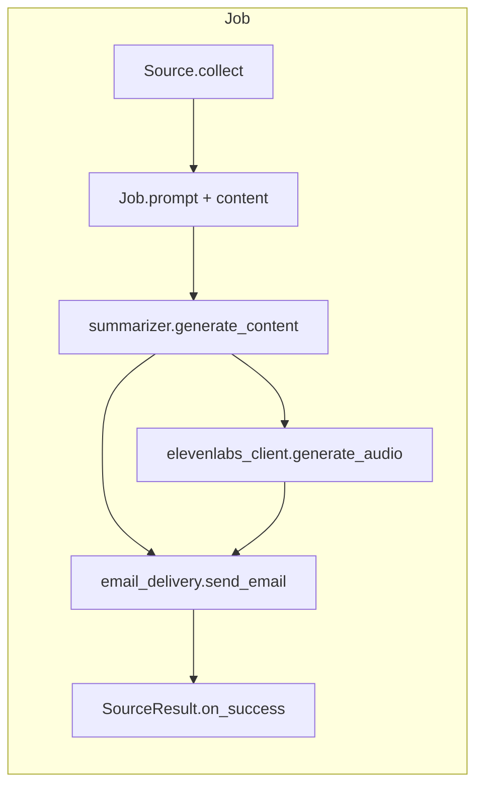

# Transcript summarizer

A **template** for Python pipelines that collect text, summarize it with **Gemini**, and deliver styled emails through **Gmail**. Every job follows the same shape:

**text → LLM + prompt → email** (optional **MP3** for daily jobs)



This repo ships two **worked examples** you can copy and adapt:

1. **NPR Indicator** (`npr_indicator`) — scrape podcast transcripts from RSS + HTML (the primary extension example).
2. **Newsletter example** (`newsletter_example`) — read allowlisted senders from a Gmail inbox (placeholder senders; replace with yours).

Delivery, HTML rendering, Gemini retry/fallback, optional ElevenLabs TTS, and CI plumbing are shared — you usually only add a `Source` + `Job`.

## Requirements

- Python 3.11+ (matches CI)
- [Gemini API key](https://ai.google.dev/)
- Gmail account with 2FA + [App Password](https://myaccount.google.com/apppasswords) (IMAP read + email delivery)
- **Audio briefings (optional):** [ElevenLabs](https://elevenlabs.io/) API key with `text_to_speech` and `voices_read` permissions

## Quick start

```bash
python -m venv venv
source venv/bin/activate   # Windows: venv\Scripts\activate
pip install -r requirements.txt
cp .env.example .env       # add GEMINI_API_KEY, GMAIL_ADDRESS, GMAIL_APP_PASSWORD
```

## Run jobs

```bash
# Safe test: collect + summarize, no send, no post-delivery hooks
python run.py --dry-run

# Example Gmail job (replace senders in jobs/definitions.py first)
python run.py --dry-run --only newsletter_example

# Weekly NPR Indicator summary
python run.py --dry-run --only npr_indicator

# Run by schedule group
python run.py --group daily
python run.py --group weekly
```

`--dry-run` does not call ElevenLabs. Audio is generated on a live run only when `ELEVENLABS_API_KEY` is set and the job has `attach_audio=True`.

### Hill-climb a briefing

Compare the live prompt (and any prompts you add) on recent inbox days. A separate model grades them. The run only reads mail: it does not send a briefing or mark mail as read.

```bash
python -m eval.hillclimb --job newsletter_example --lookback-hours 96 --max-days 3
python -m eval.hillclimb --job newsletter_example --target-min-words 800 --target-max-words 1100
```

By default the candidates are the live prompt on each model in `DEFAULT_MODELS` / `GEMINI_MODELS`. For a one-off prompt experiment, add entries to `EXTRA_CANDIDATES` in `eval/candidates.py`, run the hill climb, copy the winner into the job, and clear `EXTRA_CANDIDATES` again. The rubric lives in `eval/grader.py`. The same command is the manual workflow [`.github/workflows/eval-briefing.yml`](.github/workflows/eval-briefing.yml). Results go under `eval/results/` (gitignored).

### Built-in example jobs

| Key | Group | Audio | Description |
|-----|-------|-------|-------------|
| `newsletter_example` | daily | yes | Gmail inbox briefing (placeholder senders — customize before use) |
| `npr_indicator` | weekly | no | NPR Indicator transcript digest (RSS + scrape) |

### Tests

```bash
pytest -q
```

## Environment variables

| Variable | Required | Purpose |
|----------|----------|---------|
| `GEMINI_API_KEY` | Yes | Gemini API access |
| `GEMINI_MODELS` | No | Comma-separated model priority list. The code default lives in `summarizer.py` as `DEFAULT_MODELS` (`gemini-flash-latest`, then `gemini-flash-lite-latest`). Those are aliases Google moves to the current Flash and Flash-Lite releases. A numbered id such as `gemini-3.8-flash` does not move. There is no bare `gemini` name. A GitHub Actions secret named `GEMINI_MODELS` overrides the default for scheduled runs; `GEMINI_MODEL` is the legacy single-model override, used only when `GEMINI_MODELS` is unset. The next model is used after daily quota exhaustion, persistent 503s, or stalled HTTP connections. |
| `GEMINI_HTTP_TIMEOUT_MS` | No | Per-request Gemini HTTP timeout in milliseconds (default `120000`). Prevents a single hung call from eating the whole Actions job. |
| `GMAIL_ADDRESS` | Yes | Gmail address for IMAP + delivery |
| `GMAIL_APP_PASSWORD` | Yes | Gmail app password |
| `BRIEFING_TO_EMAIL` | No | Email recipient (defaults to `GMAIL_ADDRESS`) |
| `BRIEFING_DELIVERY` | No | `imap` (default for self-send) or `smtp` |
| `BRIEFING_LOOKBACK_HOURS` | No | Inbox lookback window (default `24`) |
| `ELEVENLABS_API_KEY` | No | If set, jobs with `attach_audio=True` attach an MP3 audio briefing (ElevenLabs `eleven_turbo_v2_5`) |
| `AUDIO_TEMPO` | No | Playback speed multiplier for the ElevenLabs MP3 via ffmpeg `atempo` (default `1.5`) |
| `SUMMARY_WEEK_REFERENCE` | No | Pin NPR calendar week for testing |

## Project layout

| Path | Role |
|------|------|
| `run.py` | CLI entry point |
| `jobs/` | Job registry, runner, and example definitions |
| `jobs/base.py` | `Job`, `Source`, `SourceResult`, `run_job()` |
| `jobs/sources.py` | `GmailSource`, `NprIndicatorSource` |
| `jobs/definitions.py` | Example job configs and prompts — **start here** |
| `email_delivery.py` | Gmail delivery (IMAP inbox append or SMTP) |
| `email_html.py` | Shared Markdown → styled HTML |
| `summarizer.py` | Gemini client with retry logic, HTTP timeouts, and model fallback |
| `gmail_client.py` | Gmail IMAP read + mark-as-read (`peek` for read-only hill climbs) |
| `elevenlabs_client.py` | Optional ElevenLabs TTS for MP3 audio briefings |
| `briefing_length.py` | Word counts and listen-time estimates |
| `eval/` | Manual hill climb: candidates, grader, and report |
| `scraper.py` | NPR RSS + transcript fetch — **copy for other podcasts** |
| `summaries/` | Saved NPR weekly summaries (`on_success` hook) |

## Audio briefings

When `ELEVENLABS_API_KEY` is set, live jobs with `attach_audio=True` generate an MP3 via ElevenLabs and attach it to the email as `briefing.mp3`. The example newsletter job opts in; the weekly NPR job stays text-only. Set the flag on any job you want spoken.

- **Model:** `eleven_turbo_v2_5`
- **Voice:** Brian (default voice ID in `elevenlabs_client.py`)
- **Speed:** ElevenLabs renders at `1.0x`; ffmpeg `atempo=1.5` by default (`AUDIO_TEMPO` to override)
- **Requires:** `ffmpeg` on the machine. The daily workflow installs Ubuntu's signed `ffmpeg` package, with each apt attempt capped at 3 minutes and one retry. If install still fails, text briefings still send and the audio attachment is skipped.
- **Dry run:** `--dry-run` skips ElevenLabs to avoid API usage
- **Failure behavior:** If audio generation fails, the text briefing still sends

The pipeline strips markdown formatting via `clean_for_tts()` before sending text to ElevenLabs so headings and links sound natural when spoken.

Create a restricted ElevenLabs API key with only `text_to_speech` and `voices_read`. MP3 attachments are a few MB each; consider a Gmail filter to auto-delete briefing emails after ~14 days.

To change the voice, pass a different `voice_id` to `generate_audio()` in [`elevenlabs_client.py`](elevenlabs_client.py).

## Customize the NPR scraper (extension example)

[`scraper.py`](scraper.py) and [`NprIndicatorSource`](jobs/sources.py) show how to wire web scraping into the pipeline:

| Customize | Where |
|-----------|--------|
| RSS feed URL | `scraper.RSS_URL` |
| Transcript link from RSS entry | `scraper._transcript_url()` |
| HTML content selector | `scraper.fetch_transcript()` |
| Calendar week bounds | `scraper.get_episodes_for_calendar_week()` |
| Output file path | `jobs/sources._save_npr_summary()` |

For a different podcast or site: copy `scraper.py`, adjust the selectors, add a new `Source` class, and register a `Job`.

## Customize the Gmail inbox path

1. Open [`jobs/definitions.py`](jobs/definitions.py).
2. Replace `newsletter@example.com` with your newsletter sender addresses.
3. Edit the prompt for your tone and structure.
4. Optionally add an `include_filter` on `GmailSource` to skip unwanted editions (see `GmailSource` in [`jobs/sources.py`](jobs/sources.py)).

Duplicate the example job for multiple categories (e.g. tech, sports) with different sender lists and prompts.

## Add a new job from scratch

You do **not** need to touch delivery, HTML rendering, Gemini calls, or TTS wiring.

### 1. Write a `Source`

```python
from jobs.base import SourceResult

class MyCustomSource:
    def collect(self) -> SourceResult:
        text = my_scraper_or_script()
        if not text.strip():
            return SourceResult(prompt_text="", has_content=False)

        return SourceResult(
            prompt_text=f"Here is the content to summarize:\n\n{text}",
            has_content=True,
            dry_run_summary="Optional note printed during --dry-run",
            on_success=lambda markdown: save_artifact(markdown),
        )
```

### 2. Register a `Job`

Add to [`jobs/definitions.py`](jobs/definitions.py):

```python
Job(
    key="my_job",
    display_name="My Job",
    group="daily",
    subject_prefix="My Job Briefing",
    intro_template="Your briefing for <strong>{date}</strong> is below.",
    prompt="You are an expert editor. Summarize the following...",
    build_source=lambda: MyCustomSource(),
    markdown_prefix="# My Job - {date}\n\n",
)
```

Set `attach_audio=True` on the `Job` when a live run should attach an MP3 and `ELEVENLABS_API_KEY` is set.

### 3. Test and run

```bash
pytest -q
python run.py --dry-run --only my_job
python run.py --only my_job
```

## GitHub Actions

Configure repository secrets: `GEMINI_API_KEY`, optional `GEMINI_MODELS` (or legacy `GEMINI_MODEL`), optional `GEMINI_HTTP_TIMEOUT_MS`, `GMAIL_ADDRESS`, `GMAIL_APP_PASSWORD`, optional `ELEVENLABS_API_KEY`.

### Daily newsletter (example)

[`.github/workflows/daily-briefing.yml`](.github/workflows/daily-briefing.yml) — **manual dispatch only**. GitHub `schedule` cron is UTC, which made a morning briefing unreliable, so this workflow has no `schedule`. Trigger it from an external scheduler in your timezone.

Runs `python run.py --group daily`. A failed job is retried once after a short pause. The workflow installs ffmpeg with bounded apt attempts so a mirror stall cannot block the text briefing.

#### cron-job.org setup

1. Create a GitHub fine-grained PAT (Settings → Developer settings → Fine-grained tokens) with repository access limited to this repo and **Actions: Read and write** plus **Contents: Read**.
2. Create a job at [cron-job.org](https://console.cron-job.org/jobs/create):
   - **URL:** `https://api.github.com/repos/OWNER/REPO/actions/workflows/daily-briefing.yml/dispatches`
   - **Schedule:** your local morning time, for example 8:15 AM `America/Los_Angeles`
   - **Request method:** `POST`
   - **Headers:** `Authorization: Bearer github_pat_XXXX`, `Accept: application/vnd.github+json`, `Content-Type: application/json`, and a `User-Agent`
   - **Request body:** `{"ref": "main"}`

   Use the `workflow_dispatch` URL above. The repository `/dispatches` endpoint (`repository_dispatch`) needs **Contents: Write** and returns 403 with Actions-only permissions.

3. A successful test returns **HTTP 204** and a run appears in the Actions tab.

Manual fallback: **Run workflow** in the Actions tab.

### Weekly NPR Indicator

[`.github/workflows/summarize.yml`](.github/workflows/summarize.yml) — Saturday 15:00 UTC (11:00 AM Eastern / 8:00 AM Pacific) + manual dispatch.

Friday's Indicator episode is usually in the RSS feed by Friday afternoon, but NPR often publishes the transcript later. A Friday 22:00 UTC run dropped that show. The weekly job therefore runs Saturday morning and retries unpublished transcript pages so Friday is usually included. Short weeks (holidays, no Friday show) are fine: the brief is built from whatever episodes are in the feed and have a transcript.

Runs `python run.py --group weekly` and commits new files in `summaries/`.

### Hill climb

[`.github/workflows/eval-briefing.yml`](.github/workflows/eval-briefing.yml) — manual dispatch only. It reads recent inbox mail for one job, grades prompt setups, and uploads `eval/results/` as an artifact. It does not send mail.

### Tests

[`.github/workflows/tests.yml`](.github/workflows/tests.yml) runs `pytest` on push/PR.

## License

MIT — see [LICENSE](LICENSE).
